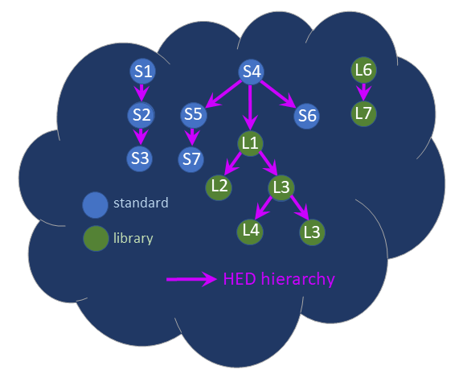
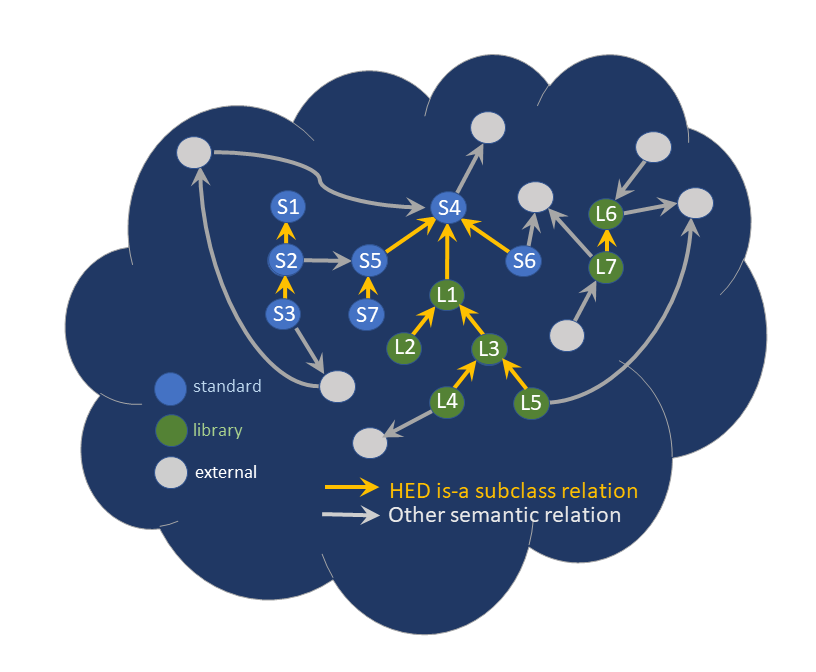
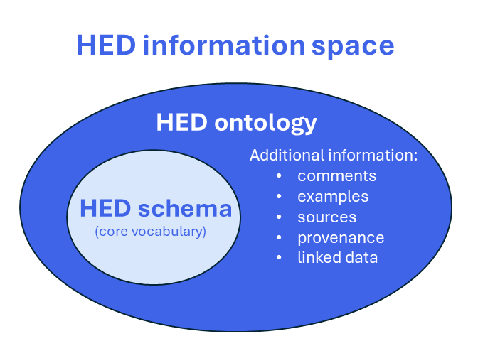
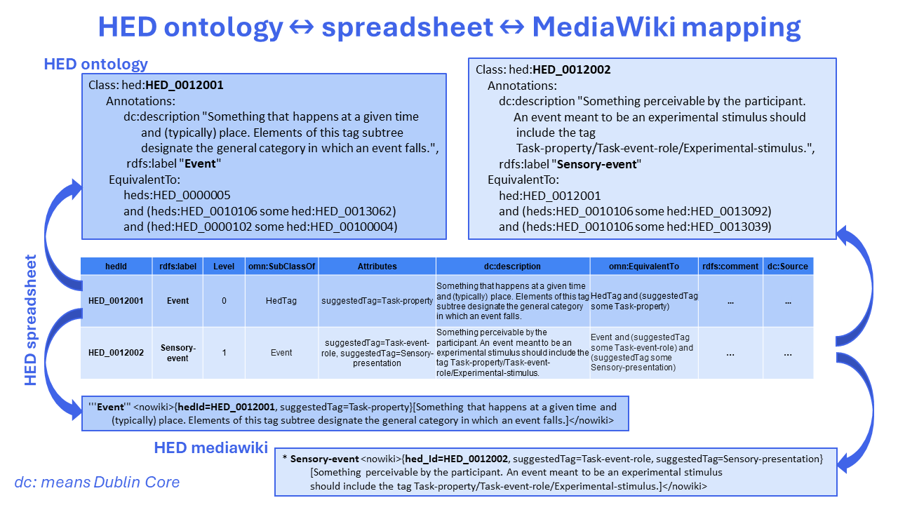

# 8. The HED ontology

This chapter defines the HED ontology and its relationship to the HED schema. HED maps all of the entities of its standard schema and library schemas (schema elements, schema attributes, schema properties, and structural elements) into a single namespace with unique [IRI](https://datatracker.ietf.org/doc/html/rfc3987) (Internationalized Resource Identifier) identifiers as explained in [8.3 HED global identifiers](#83-hed-global-identifiers).

The GitHub source repository for the HED ontologies is [hed-ontology](https://github.com/hed-standard/hed-ontology). The GitHub source repository for the HED schemas is [hed-schemas](https://github.com/hed-standard/hed-schemas).

## 8.1. HED views and representations

### 8.1.1. The annotator's view

HED (Hierarchical Event Descriptors) has a standard hierarchically-organized vocabulary (the HED standard schema) and additional community-specific vocabularies (HED library schemas) that can be used to annotate and analyze experimental data. The HED vocabularies and the supporting HED ecosystem are designed to support these activities.

The data annotator's natural view is top-down - identifying a general category and then filling out the details with more specific tags in that category or grouping with descriptive tags from other categories. As illustrated in the following diagram, the HED schema hierarchy is organized in a top-down manner to support this work-flow.



In the diagram, top-level tags `S1`, `S4`, and `L6` represent general categories and are roots of subtrees organized so that child nodes are more specific terms. HED supports "search generality", so searches may specify an exact match or matches to any term in a particular subtree. In the latter case, a search for `Event` may also match any of its descendents (e.g., `Sensory-event` or `Agent-action`).

The [HED schema viewer](https://www.hedtags.org/hed-schema-browser), allows users to focus on top-level categories or expand the hierarchy view to any specified level of detail.

### 8.1.2. The ontologist's view

A second view of HED - the HED ontology - provides a mapping between HED schemas and classical ontologies in order to support semantic analysis and reasoning.

The following diagram shows the ontology view of HED. The nodes of the HED schema are embedded in the HED ontology, but the view is "term-centric" or "bottom-up" with links from the given term to its parent class (yellow arrows) and as well links between the given term and other terms (gray arrows).



The ontology represents a complex network of interrelationships among the terms in the HED hierarchy and terms in other ontologies. The HED ontology and its mapping have been made explicit. The goal is to include links to additional information including provenance and examples during annotation and to leverage AI tools during annotation and analysis.

### 8.1.3. HED information space

The HED schema is embedded in a larger information space that includes additional information such as sources, provenance, and links to other ontologies. This HED information space is illustrated schematically in the following diagram.



The embedding is anchored by the `hedId` schema attribute. The `hedId` values are of the form `HED_xxxxxxx` and resolve to IRIs (Internationalized Resource Identifiers) in the [https://purl.org/hed/hed.owl](https://purl.org/hed/hed.owl) file. This file is currently hosted on GitHub and does not have a mechanism to address individual IDs defined within the file. The ontology files are versioned by release date. Releases are located in the [releases](https://github.com/hed-standard/hed-ontology/tree/main/releases) subdirectory of the [hed-ontology](https://github.com/hed-standard/hed-ontology) repository on GitHub.

The extended information space is completely represented by the HED ontology in OWL format. In this document we use OWL Manchester format (`.omn`) for readability.

### 8.1.4. HED representations

The HED vocabularies are held in the four schema formats (MediaWiki, XML, JSON, and TSV; see [3.1. Schema rules](./03_HED_formats.md#31-schema-rules)), which are equivalent, and in the HED ontology (OWL), as shown in the following table:

| Format    | Content                                | Uses                                                                                      | Editing                                                        |
| --------- | -------------------------------------- | ----------------------------------------------------------------------------------------- | -------------------------------------------------------------- |
| MediaWiki | Schema                                 | Schema development<br/>Schema updating                                                    | Manual editing<br/>Updated from TSV                            |
| XML       | Schema                                 | Annotation tools<br/>Validation tools<br/>Analysis tools                                  | Generated from MediaWiki                                       |
| JSON      | Schema                                 | AI tools                                                                                  | Generated from MediaWiki                                       |
| TSV       | Schema, with optional ontology columns | Schema development<br/>Schema updating<br/>Ontology updating                              | Manual editing<br/>Updated from MediaWiki<br/>Updated from OWL |
| OWL       | Complete                               | Ontology updating<br/>Semantic validation<br/>Documentation generation<br/>Semantic tools | Manual editing<br/>Updated from TSV                            |

The HED schema, which contains the core HED vocabulary and captures the "annotator's view" of HED, can be completely represented in the HED MediaWiki, XML, JSON, or TSV formats. The HED schema is used for annotation, validation, searching, and most analyses. Tools access the HED schema in its XML format, but schema developers usually create and update the schema in MediaWiki format, which is easier to read and displays as formatted MarkDown on GitHub. Alternatively schema developers may opt to create or update schemas from the HED TSV files.

#### 8.1.4.1. The MediaWiki format

The MediaWiki format is line-oriented with each non-blank line corresponding to a HED tag or other HED entity such as a unit class or schema attribute definition. See [A.2. MediaWiki file format](./Appendix_A.md#a2-mediawiki-file-format) for a detailed description of the MediaWiki format.

#### 8.1.4.2. TSV files

The TSV format consists of 13 tab-separated value (tsv) files each containing the information for one type of HED entity as summarized in the following table.

| tsv filename                     | Contents                                                                               |
| -------------------------------- | -------------------------------------------------------------------------------------- |
| `xxx_AnnotationProperty`         | These correspond to schema attributes that are not inherited.                          |
| `xxx_AnnotationPropertyExternal` | Rows of the `External annotations` extra section.                                      |
| `xxx_AttributeProperty`          | Definitions of the schema properties (the `Properties` section of the MediaWiki file). |
| `xxx_DataProperty`               | Schema attributes whose value is a literal such as boolean, string or numeric.         |
| `xxx_ObjectProperty`             | Schema attributes whose value is another schema entity such as a HED tag.              |
| `xxx_Prefixes`                   | Rows of the `Prefixes` extra section.                                                  |
| `xxx_Sources`                    | Rows of the `Sources` extra section.                                                   |
| `xxx_Structure`                  | The structural elements: header, prologue, and epilogue.                               |
| `xxx_Tag`                        | Definitions of the HED tags (vocabulary) in the schema.                                |
| `xxx_Unit`                       | Definitions of the HED unit entities.                                                  |
| `xxx_UnitClass`                  | Definitions of the HED unit classes.                                                   |
| `xxx_UnitModifier`               | Definitions of the HED unit modifiers.                                                 |
| `xxx_ValueClass`                 | Definitions of the HED value classes.                                                  |

The `xxx_` prefix identifies the schema version. For example, the prefix for standard schema version `8.3.0` is `HED8.3.0_` and the prefix for SCORE library schema `2.0.0` is `HED_score_2.0.0_`.

Most schema developers will only edit the `xxx_Tag.tsv` file or the `xxx_Structure.tsv` file.

#### 8.1.4.3. TSV format

Each HED TSV file starts with a one-line header containing the column names of the file. The header row of each file is given in [A.5.2. TSV header formats](./Appendix_A.md#a52-tsv-header-formats). The rows of the three extras files (`xxx_Sources`, `xxx_Prefixes`, and `xxx_AnnotationPropertyExternal`) are not schema elements and have no `hedId`.

The prefixes on column names have the following meanings:

| Column name prefix | Meaning                                                                                                        |
| ------------------ | -------------------------------------------------------------------------------------------------------------- |
| `rdfs:`            | from [RDF Schema](https://en.wikipedia.org/wiki/RDF_Schema) (i.e., the Resource Description Framework Schema). |
| `dc:`              | from [DublinCore Ontology](https://www.dublincore.org/resources/glossary/ontology/).                           |
| `omn:`             | translated directly to OWL Manchester Format.                                                                  |

Users may add additional columns corresponding to annotation properties from the Dublin Core or the RDF schema (e.g., `dc:comment`) and the HED ontology framework will include them in the ontology. However, these columns do not impact the HED schema.

HED schema developers can develop in either HED MediaWiki or HED TSV (tab-separated-value) file format and can use tools to update the representations; [A.5. TSV file format](./Appendix_A.md#a5-tsv-file-format) describes the columns of each file. Users may NOT assign or modify the `hedId`. When creating a new entity such as a tag, leave the `hedId` column blank. If adding a new tag to the MediaWiki file, schema developers should omit the `hedId`. Tools will assign and validate the `hedId` during the update process.

#### 8.1.4.4. Tag TSV file \<--> Ontology

HED TSV files have been expanded to include additional columns to capture all the information contained in the HED ontology as illustrated in the following example. Notice that while the TSV file always refers to the entities by name (e.g., `rdfs:label`), the ontology uses the `hedId`.



The HED ontology represents the entire HED information space in [OWL](https://www.w3.org/TR/owl2-overview/) (Web Ontology Language). The HED ontology is available in both [OWL/RDF](https://www.w3.org/TR/owl2-mapping-to-rdf/) format and [OWL Manchester](https://www.w3.org/TR/owl2-manchester-syntax/) format, but the examples in this specification use OWL Manchester format for readability. Developers must use the HED TSV files to create or update a HED ontology.

The schema elements (tags with their `#` placeholders, unit classes, units, unit modifiers, and value classes) and the structural elements map to classes in the HED ontology. The HED schema attributes, which describe properties and behavior, are mapped to ontology properties as described in [8.2.3. Schema attributes](#823-schema-attributes) section. The schema properties, which describe the schema attributes, map to annotation properties and determine the kind of ontology property that each schema attribute becomes.

The mapping of the TSV row and column values to a class in the HED ontology is further explained in the following table:

| TSV<br/>column     |     Row value     | Ontology format                                                                                                                    |
| ------------------ | :---------------: | ---------------------------------------------------------------------------------------------------------------------------------- |
| **hedId**          |       *xxx*       | `Class: hed:xxx`                                                                                                                   |
| **rdfs:label**     |       *yyy*       | `rdfs:label yyy` in the `Annotations` section                                                                                      |
| **Level**          |        *n*        | Redundant information - can be recovered using class hierarchy.                                                                    |
| **omn:SubClassOf** |       *zzz*       | The tag is either a `SubClassOf` or `EquivalentTo` *zzz*<br/>but *zzz* is identified in the ontology<br/>by **hedId** rather name. |
| **Attributes**     | *uuu*, *vvv*, ... | If non-empty, then these appear as restrictions<br/> in the `EquivalentTo`. See [8.2.3. Schema attributes](#823-schema-attributes) |
| **dc:description** |       *www*       | `dc:description www` in the `Annotations` section.                                                                                 |

The next section describes the ontology structure in more detail.

## 8.2. HED schema to ontology

Each HED entity of a schema (see [HED entity](./02_Terminology.md#hed-entity)) - each schema element, schema attribute, schema property, and structural element - is assigned a persistent globally unique identifier (GUID). This GUID appears as the entity identifier in the ontology and, for every entity except the structural elements, as the value of its `hedId` attribute in the HED schema (see [8.3.1. Schema namespaces versus the ontology namespace](#831-schema-namespaces-versus-the-ontology-namespace)). The classes and properties of the base ontology, such as `HedTag` and `inHedSchema`, have identifiers of the same form.

The base ontology is the set of classes and properties, shared by all schemas, from which the entities of each schema are defined. It has three top classes. `HedEntity` (`hed:HED_0000001`) is the parent of the other two. `HedElement` (`hed:HED_0000003`) is the class of the schema elements; `HedTag`, `HedUnitClass`, `HedUnit`, `HedUnitModifier`, and `HedValueClass` are defined from it. `HedStructure` (`hed:HED_0000002`) is the class of the structural elements; `HedSchema`, `HedHeader`, `HedPrologue`, and `HedEpilogue` are defined from it. Schema attributes and schema properties are HED entities that are not classes: each is an ontology property (see [8.2.3. Schema attributes](#823-schema-attributes)).

The examples in this section write identifiers with the `hed:` prefix.

### 8.2.1. Overall ontology structure

HED requires that child tags of tags in the HED schema satisfy the **is-a** relationship. This requirement is satisfied in HED ontology using subclass relationship. The HED requirement of orthogonality between tags in different top-level subtrees can be captured in the HED ontology by imposing *disjointness* on the top-level trees, but this is not currently being enforced.

The following table summarizes how the HED schema and HED ontology are mapped.

```{list-table} HED ontology structure.
---
widths: 15 75
header-rows: 1
---
* - Schema
  - Ontology
* - **Header**
  - Class with `DataProperty` values for:
    * `version` - (required) semantic version of schema.
    * `library` - (optional) library name if library.
    * `withStandard` - (optional) semantic version of library's standard partner.
    * `unmerged` - (optional) the library schema is stored in unmerged form.
* - **Tag**
  - Class representing HED tags:
    * Defined in the `schema` section of the HED schema.
    * Uses subclassing to represent HED schema structure.
    * Top-level tags extend `HedTag` (`hed:HED_0000005`).
    * A rooted library tag extends its root in the standard schema.
    * The parent class appears either in `SubClassOf` or `EquivalentTo`.
* - **Unit class**
  - Defined in the `Unit classes` section of the HED schema.
    * Usually only defined in the standard schema.
    * Defining schema must define a class extending `HedUnitClass` (`hed:HED_0000006`).
    * Unit classes in the standard schema are subclasses of `StandardUnitClass` (`hed:HED_0010006`).
* - **Unit**
  - * Defined in the `Unit classes` section of HED schema under its unit class.
    * Usually only defined in the standard schema.
    * Defining schemas must define a class extending `HedUnit` (`hed:HED_0000007`).
    * Units in the standard schema are subclasses of `StandardUnit` (`hed:HED_0010007`).
    * The class must have the `hasUnitClass` (`hed:HED_0000103`) `ObjectProperty`.
* - **Unit modifier**
  - * Defined in the `Unit Modifiers` section of the HED schema.
    * Usually only defined in the standard schema
    * Defining schemas must define a class extending `HedUnitModifier` (`hed:HED_0000008`).
    * Unit modifiers in the standard schema inherit from `StandardUnitModifier` (`hed:HED_0010008`).
* - **Value class**
  - * Defined in the `Value classes` section of the HED schema.
    * Usually only defined in the standard schema.
    * Defining schemas must define a class extending `HedValueClass` (`hed:HED_0000009`).
    * Value classes in the standard schema inherit from `StandardValueClass` (`hed:HED_0010009`).
* - **Schema attribute**
  - Maps as a property in the HED ontology:
    * `ObjectProperty` if `Range` is a class and it is inherited (no `AnnotationProperty`).
    * `DataProperty` if `Range` is a literal (boolean, numeric, or string) and it is inherited.
    * `AnnotationProperty` if not inherited.
* - **Schema property**
  - * Defined in the `Properties` section of the HED schema.
    * Property names ending in `Domain` specify classes the attribute can be applied to.
    * Property names ending in `Range` specify values the property can have.
    * The `annotationProperty` property indicates that the schema attribute is not inherited.
    * Each is an `AnnotationProperty` in the HED ontology.

```

### 8.2.2. HED Tags

The HED schema hierarchy is captured by subclassing in the HED ontology. Top-level tag nodes in the HED schema are defined from the `HedTag` class (`hed:HED_0000005`), restricted to the schema they belong to, and so are subclasses of it. A descendant of a top-level tag node is a direct subclass of its parent tag node in the HED schema. The ontology subclass relationship enforces the HED requirement that each tag in the HED schema must satisfy the **is-a** relationship with its parent in the HED schema.

The example of this section uses the `Action` tag and its child `Communicate` to illustrate how subclassing is represented in the ontology.

#### 8.2.2.1. OWL format for HED classes

We use the [OWL Manchester syntax](https://www.w3.org/TR/owl2-manchester-syntax/) for the examples in this specification document because of readability. The HED ontology is also distributed in OWL/RDF format.

The following example illustrates the syntax for the HED mapping. HED schema elements (tags, unit classes, unit modifiers, units, and value classes) are mapped to OWL classes. Every element has a unique `hedId`, which is the identifier of its class in the ontology. The `rdfs:label` annotation value is the name of the element as it appears in the HED schema. The `dc:description` annotation value is the description of the element in the HED schema.

````{admonition} **Example** HED Manchester OWL syntax.

```yaml
Class: hed:HED_0012016
    Annotations:
        dc:description "Do something.",
        rdfs:label "Action"
    EquivalentTo:
        hed:HED_0000005
        and (hed:HED_0000102 some hed:HED_0010004)
        and (hed:HED_0010307 value true)

Class: hed:HED_0012017
    Annotations:
        dc:description "Action conveying knowledge of or about something.",
        rdfs:label "Communicate"
    SubClassOf:
        hed:HED_0012016
```


The `Action` (`hed:HED_0012016`) class is a top level schema tag and
therefore a subclass of `HedTag` (`hed:HED_0000005`).
The parentage relationship is represented by `EquivalentTo` rather than `SubClassOf`
because `Action` has property restrictions: the `extensionAllowed` (`hed:HED_0010307`) data property
and the `inHedSchema` (`hed:HED_0000102`) object property.
Every top-level tag has the `inHedSchema` restriction, so every top-level tag is defined with `EquivalentTo`.
Here `hed:HED_0010004` is the `StandardSchema` class, which has been declared elsewhere in the ontology.

The `Communicate` HED tag (`hed:HED_0012017`) is a direct child of `Action` as indicated by the `SubClassOf` entry.
Since `Communicate` is a subclass of `Action`, it inherits the `inHedSchema` association
with the correct version of the standard schema.
````

### 8.2.3. Schema attributes

The purpose of HED schema attributes is to specify characteristics and/or behavior of HED schema elements, including tags, unit classes, units, unit modifiers, and value classes. These attributes map schema elements into values or into other schema elements.

#### 8.2.3.1. Attribute ontology types

A given HED schema attribute's representation in the HED ontology is determined by its domain, its range, and whether the attribute is inherited. The mapping strategy is summarized in the following table.

| Ontology             | Domain         | Range                                       | Inherited? |
| -------------------- | -------------- | ------------------------------------------- | ---------- |
| `AnnotationProperty` | schema element | string, numeric, boolean, or schema element | No         |
| `DataProperty`       | schema element | string, numeric, boolean                    | Yes        |
| `ObjectProperty`     | schema element | schema element                              | Yes        |

The Domain column gives the domain of the property in the ontology, which is narrower than where the schema attribute may be written in a schema: [3.1.4.8. Schema properties](./03_HED_formats.md#3148-schema-properties) also allows an attribute that has `elementDomain` to be assigned to a schema attribute, and `hedId` and `deprecatedFrom` to a schema property. The `hedId` of a schema attribute or of a schema property is the identifier of its ontology property.

`DataProperty` and `ObjectProperty` are inherited by subclasses, and reasoners can check their consistency. `AnnotationProperty` is not inherited by subclasses, and reasoners ignore them.

#### 8.2.3.2. Schema properties

Schema properties appear in the `Properties` section of a HED schema. They determine how schema attributes behave and are described in the following table. In the ontology the schema attributes are themselves properties, which is why the TSV file that holds the schema properties is named `AttributeProperty`. In this chapter a property name in code font (`ObjectProperty`, `DataProperty`, `AnnotationProperty`) is a kind of ontology property; schema property always means an entry of the `Properties` section.

| Attribute name       | Description                                                                                                                                                |
| -------------------- | ---------------------------------------------------------------------------------------------------------------------------------------------------------- |
| `annotationProperty` | The value is not inherited by child nodes.                                                                                                                 |
| `boolRange`          | The value can be true or false. This property was formerly named `boolProperty`.                                                                           |
| `elementDomain`      | The attribute can apply to any type of element (tag, unit, unit class, unit modifier, or value class). This property was formerly named `elementProperty`. |
| `tagDomain`          | The attribute can apply to node (tag-term) elements. This property was formerly named `nodeProperty`.                                                      |
| `tagRange`           | The value can be a node (tag).                                                                                                                             |
| `numericRange`       | The value can be numeric.                                                                                                                                  |
| `stringRange`        | The value can be a string.                                                                                                                                 |
| `unitClassDomain`    | The attribute can apply to unit classes. This property was formerly named `unitClassProperty`.                                                             |
| `unitClassRange`     | The value can be a unit class.                                                                                                                             |
| `unitModifierDomain` | The attribute can apply to unit modifiers. This property was formerly named `unitModifierProperty`.                                                        |
| `unitDomain`         | The attribute can apply to units. This property was formerly named `unitProperty`.                                                                         |
| `unitRange`          | The value can be units.                                                                                                                                    |
| `valueClassDomain`   | The attribute can apply to value classes. This property was formerly named `valueClassProperty`.                                                           |
| `valueClassRange`    | The value can be a value class.                                                                                                                            |

Each schema property is translated to an `AnnotationProperty` in the ontology.

#### 8.2.3.3. Attribute representation

The following table lists schema attributes with their types (A=`AnnotationProperty`, D=`DataProperty`, and O=`ObjectProperty`), domains and ranges.

| Attribute              | Type | Domain                                                       | Range             | Handling                                  |
| ---------------------- | ---- | ------------------------------------------------------------ | ----------------- | ----------------------------------------- |
| `allowedCharacter`     | D    | `unitDomain`<br/>`unitModifierDomain`<br/>`valueClassDomain` | `stringRange`     |                                           |
| `annotation`           | A    | `elementDomain`                                              | `stringRange`     |                                           |
| `conversionFactor`     | D    | `unitDomain`<br/>`unitModifierDomain`                        | `numericRange`    |                                           |
| `defaultUnits`         | O    | `unitClassDomain`                                            | `unitRange`       |                                           |
| `deprecatedFrom`       | D    | `elementDomain`                                              | `stringRange`     |                                           |
| `extensionAllowed`     | D    | `tagDomain`                                                  | `boolRange`       |                                           |
| `hedId`                | A    | `elementDomain`                                              | `stringRange`     | Tools: Assign and verify.                 |
| `inLibrary`            | D    | `elementDomain`                                              | `stringRange`     |                                           |
| `isPartOf`             | O    | `tagDomain`                                                  | `tagRange`        |                                           |
| `relatedTag`           | O    | `tagDomain`                                                  | `tagRange`        |                                           |
| `requireChild`         | A    | `tagDomain`                                                  | `boolRange`       | Tools: Verify.                            |
| `reserved`             | D    | `tagDomain`                                                  | `boolRange`       |                                           |
| `rooted`               | A    | `tagDomain`                                                  | `tagRange`        | Tools: make tag subclass of tag in range. |
| `SIUnit`               | D    | `unitDomain`                                                 | `boolRange`       |                                           |
| `SIUnitModifier`       | D    | `unitModifierDomain`                                         | `boolRange`       |                                           |
| `SIUnitSymbolModifier` | D    | `unitModifierDomain`                                         | `boolRange`       |                                           |
| `suggestedTag`         | O    | `tagDomain`                                                  | `tagRange`        |                                           |
| `tagGroup`             | D    | `tagDomain`                                                  | `boolRange`       |                                           |
| `takesValue`           | A    | `tagDomain`                                                  | `boolRange`       | Only placeholders                         |
| `topLevelTagGroup`     | D    | `tagDomain`                                                  | `boolRange`       |                                           |
| `unique`               | D    | `tagDomain`                                                  | `boolRange`       |                                           |
| `unitClass`            | O    | `tagDomain`                                                  | `unitClassRange`  |                                           |
| `unitPrefix`           | D    | `unitDomain`                                                 | `boolRange`       |                                           |
| `unitSymbol`           | D    | `unitDomain`                                                 | `boolRange`       |                                           |
| `valueClass`           | O    | `tagDomain`                                                  | `valueClassRange` |                                           |

#### 8.2.3.4. OWL format for attributes

The Manchester Owl syntax for schema attributes is similar to that of classes above. The following example shows the OWL definition for the HED `extensionAllowed dataProperty`:

````{admonition} **Example** HED Manchester OWL syntax for DataProperty extensionAllowed.

```text
DataProperty: hed:HED_0010307
    Annotations:
        dc:description "Users can add unlimited levels of child nodes under this tag. This tag is propagated to child nodes except for hashtag placeholders.",
        rdfs:label "extensionAllowed",
        hed:HED_0010704 true,
		hed:HED_0010702 true
    Domain:
        hed:HED_0000005
    Range:
        xsd:boolean

```
````

The HED `DataProperty` entities map an entity (Domain) into a value (Range) as specified by the `Domain` and `Range` fields. The `hed:HED_0000005` ID is the `HedTag` class. In the HED schema, the domain and range of a schema attribute are conveyed by the schema properties, which are also given as annotation properties. The `hed:HED_0010704 true` annotation corresponds to the `tagDomain` schema property being true, while the `hed:HED_0010702 true` annotation corresponds to the `boolRange` schema property being true.

Similarly, the HED `ObjectProperty` entities map an entity (Domain) into another entity (Range) specified by the `Domain` and `Range` fields as illustrated in the following example:

````{admonition} **Example** HED Manchester OWL syntax for suggestedTag.
```text
ObjectProperty: hed:HED_0010106
	Annotations:
		dc:description "A tag that is often associated with this tag. This attribute is used by tagging tools to provide tagging suggestions.",
		rdfs:label "suggestedTag",
		hed:HED_0010704 true,
		hed:HED_0010705 true
	Domain:
		hed:HED_0000005
	Range:
		hed:HED_0000005
```
````

The `hed:HED_0000005` ID is the `HedTag` class, indicating that `suggestedTag` maps one HED tag into another. The `hed:HED_0010704 true` and `hed:HED_0010705 true` provide this information as annotations.

Unlike `DataProperty` and `ObjectProperty` attributes, `AnnotationProperty` attributes are not inherited and do not use domain and range specifications. These must be handled individually by tools as flagged by the HED schema `annotationProperty` property.

````{admonition} **Example** HED Manchester OWL syntax for rooted.

```text
AnnotationProperty: hed:HED_0010502
    Annotations:
        dc:description "This top-level library schema node should have a parent which is the indicated node in the partnered standard schema.",
        rdfs:label "rooted",
        hed:HED_0010704 true,
		hed:HED_0010705 true
````

### 8.2.4. Other auxiliary sections

The schema-ontology mapping for HED schema units, unit classes, unit modifiers, and value classes is similar to that of HED tags. However, each of these auxiliary items should inherit from a superclass tied to the schema in which they are defined.

For example the value classes that are defined in the standard schema should inherit from `StandardValueClass` (`hed:HED_0010009`) not directly from `HedValueClass` (`hed:HED_0000009`).

## 8.3. HED global identifiers

### 8.3.1. Schema namespaces versus the ontology namespace

HED uses the word namespace in two different senses, and the two must not be confused.

A **schema namespace** (see [Namespace](./02_Terminology.md#namespace) and [3.1.2. Version combinations](./03_HED_formats.md#312-version-combinations)) is a mechanism for combining several schemas into a unified vocabulary for a particular application. The annotator chooses a namespace name for each additional schema in the dataset's HED version specification and writes the corresponding namespace prefix (e.g., `sc:`) in front of the tags drawn from that schema. Schema namespaces are dynamic: they are chosen per dataset, are not part of any schema, and say nothing about the identity of the tags they qualify. The same tag may appear with different prefixes in different datasets, much as the same Python module may be imported under different names with `import ... as`.

The **ontology namespace** is the set of global identifiers of the form `HED_xxxxxxx`, where `xxxxxxx` is a 7-digit integer. Every HED entity of a schema (schema element, schema attribute, schema property, or structural element) is assigned an identifier of this form when the schema is released. For every entity except the structural elements, the identifier is recorded as the value of its [`hedId`](./Appendix_A.md#a147-hedid) schema attribute; the identifiers of the header, prologue, and epilogue are assigned by tools and recorded in the `Structure` file of the TSV format. The identifiers are allocated by schema, not by schema version: the base ontology occupies `HED_0000001` to `HED_0009999`, the standard schema occupies `HED_0010000` to `HED_0039999`, and each library schema is assigned its own range when it is first created, as recorded in [library_data.json](https://github.com/hed-standard/hed-schemas/blob/main/library_data.json) in the [hed-standard/hed-schemas](https://github.com/hed-standard/hed-schemas) repository. Within each schema's range, every kind of entity has a fixed subrange, so the `hedId` alone reveals both the schema an entity came from and what kind of entity it is. The subranges are listed in [8.3.2. Ontology namespace](#832-ontology-namespace).

A `hedId` assignment is permanent. Once an entity has been given an identifier, that identifier represents the entity in the ontology through all later schema versions, even if the entity is renamed, moved, or deprecated, and the identifier is never reassigned to another entity. The `hedId` values are used to construct a valid ontology in OWL format from the schema, as described in [8.3.3. HED IRIs](#833-hed-iris).

Identifiers are assigned when a schema is released, after Working Group review; new entities in a prerelease carry none. Should an identifier nonetheless appear in a prerelease and be withdrawn before release, as `HED_0010308` was in the `8.3.0` prerelease, it is retired like one whose entity is removed from a released schema. Either kind is recorded in the `retired_ids` section of [library_data.json](https://raw.githubusercontent.com/hed-standard/hed-schemas/refs/heads/main/library_data.json) in the hed-schemas repository, with the entity's label, the version that removed it, the reason, and any replacement. A retired identifier is never reused, and the entity it identified remains in the HED ontology, marked as deprecated. HED `8.5.0` retires `HED_0011644` (`uV`, now derived as `u` + `V`).

In short, the ontology namespace fixes what an entity *is*, independent of any schema version or dataset, while a schema namespace fixes how an annotator *refers to* a tag in one dataset's version specification. Tools resolve a prefixed tag through the version specification to a schema element, and from there through `hedId` to its ontology identifier and its [IRI](#833-hed-iris).

### 8.3.2. Ontology namespace

The HED ontology uses globally unique identifiers (GUIDs) of the form `HED_xxxxxxx` for all entities of HED schemas.

All HED standard and library schema entities are mapped to the `HED_xxxxxxx` namespace using the range assignments described in the following table.

| HED ID                       | Owl type             | Description                                                                 |
| ---------------------------- | -------------------- | --------------------------------------------------------------------------- |
| HED_0000001-<br/>HED_0000099 | `Class`              | Base class (EX: `HedTag`).                                                  |
| HED_0000100-<br/>HED_0000299 | `ObjectProperty`     | Base object property (EX: `hasUnitClass`).                                  |
| HED_0000300-<br/>HED_0000499 | `DataProperty`       | Base data property (EX: `library`).                                         |
| HED_0000500-<br/>HED_0000999 | `AnnotationProperty` | Base annotation property (EX: `hedId`).                                     |
| HED_0010001-<br/>HED_0010099 | `Class`              | Standard schema structure class (EX: `StandardHeader`).                     |
| HED_0010100-<br/>HED_0010299 | `ObjectProperty`     | Standard schema attribute that is an object property (EX: `suggestedTag`).  |
| HED_0010300-<br/>HED_0010499 | `DataProperty`       | Standard schema attribute that is a data property (EX: `extensionAllowed`). |
| HED_0010500-<br/>HED_0010699 | `AnnotationProperty` | Standard schema attribute that is not inherited (EX: `takesValue`).         |
| HED_0010700-<br/>HED_0010899 | `AnnotationProperty` | Standard schema property (EX: `tagDomain`).                                 |
| HED_0011300-<br/>HED_0011399 | `HedValueClass`      | Standard schema value class (EX:`textClass`).                               |
| HED_0011400-<br/>HED_0011499 | `HedUnitModifier`    | Standard schema unit modifier (EX: `deca`).                                 |
| HED_0011500-<br/>HED_0011599 | `HedUnitClass`       | Standard schema unit class (EX: `timeUnits`).                               |
| HED_0011600-<br/>HED_0011699 | `HedUnit`            | Standard schema unit (EX: `hour`).                                          |
| HED_0012000-<br/>HED_0039999 | `HedTag`             | Standard schema HED tag (EX: `Sensory-event`).                              |
| HED_0042000-<br/>HED_0059999 | `HedTag`             | SCORE schema HED tag (EX: `Episode`).                                       |
| HED_0062000-<br/>HED_0079999 | `HedTag`             | LANG schema HED tag.                                                        |
| HED_0082000-<br/>HED_0099999 | `HedTag`             | SLAM schema HED tag.                                                        |
| HED_0102000-<br/>HED_0119999 | `HedTag`             | MOUSE schema HED tag (EX: `Lick`).                                          |

### 8.3.3. HED IRIs

HED IRIs [(**Internationalized Resource Identifiers**)](https://datatracker.ietf.org/doc/html/rfc3987) are mapped to [https://purl.org/hed/hed.owl](https://purl.org/hed/hed.owl).
